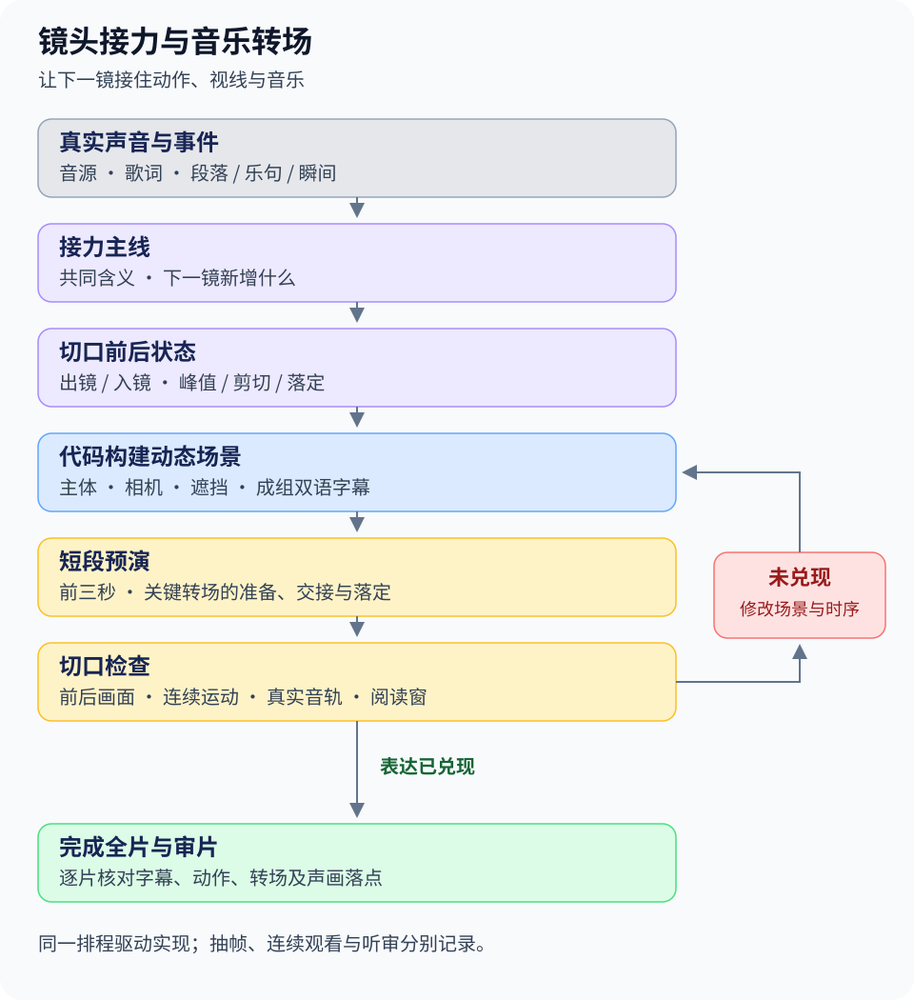
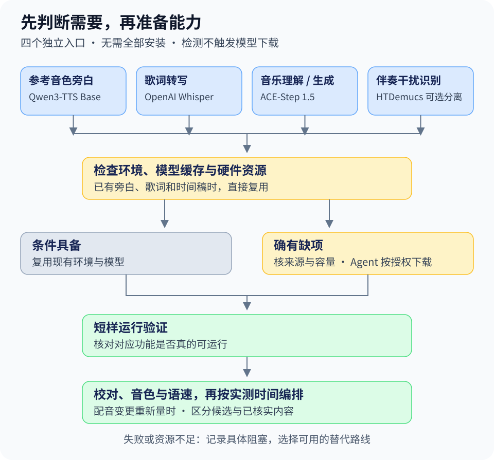
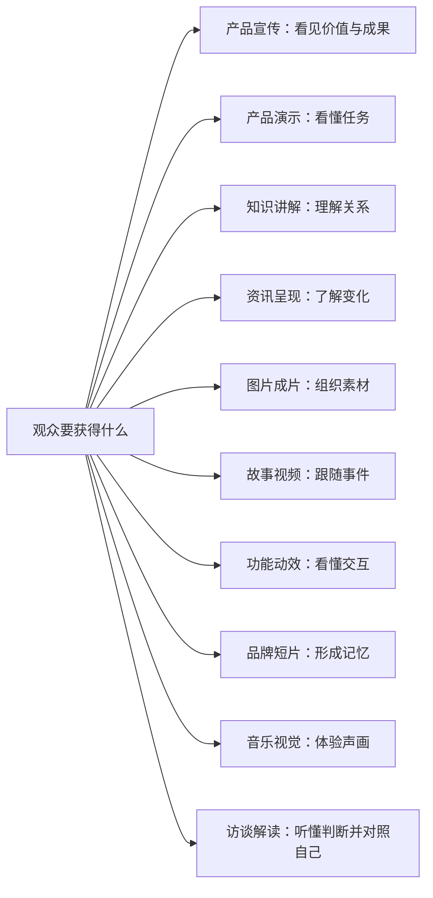
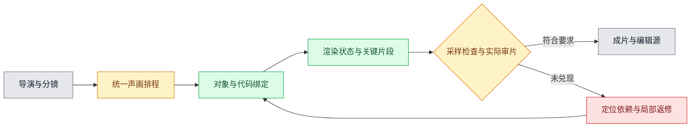

# 超级峰的视频设计方法论

让 AI Agent 把产品、音乐、主题和素材编排成视频，交付成片与可编辑工程。

[观看作品](#创作案例) · [浏览风格](#开源集成的-59-套影片风格) · [安装使用](#安装) · [产品宣传](#产品宣传视频参考模板或源码) · [音乐编排](#音乐视频怎样编排) · [在线画廊](https://mileson.github.io/chaojifeng-video-design/)

## 创作案例

点击播放器观看，均保留原声。每条视频下方附一句话指令，把【】换成你的素材，即可开始复刻。

### 音乐视觉作品

四段音乐视觉作品，均为 15 秒高亮；诗词意象的做法见 [诗词音乐世界](references/poetry-music-world.md)。

<table width="100%">
<tr>
<td width="25%" valign="top">

https://github.com/user-attachments/assets/95b117d6-ba08-4714-9869-c0dc6b7cdab1

**水墨山河**

用 $chaojifeng-video-design，以【音乐文件】做一支水墨风格的三维音乐视频：墨点起势，穿过峡谷，随高潮拉升成山河。

</td>
<td width="25%" valign="top">

https://github.com/user-attachments/assets/de15cfd8-d5f6-4a2d-9d11-bf17b719cc8a

**青花烟雨**

用 $chaojifeng-video-design，以【音乐文件】做一支烟雨风格的三维音乐视频：从青花器物的纹样走进烟雨山水，让乐句带动空间变化。

</td>
<td width="25%" valign="top">

https://github.com/user-attachments/assets/d585b421-229a-401b-8006-09e12e468305

**琵琶江月**

用 $chaojifeng-video-design，以【音乐文件】做一支诗词意象的三维音乐视频：月下拨弦，让水波、笔触与立体诗字依次接力，从留白走向爆发。

</td>
<td width="25%" valign="top">

https://github.com/user-attachments/assets/dbc46343-0914-4c86-a258-c79100bd1997

**三维数学世界**

用 $chaojifeng-video-design，以【音乐文件】做一支理论概念的三维音乐视频：穿越无穷符号，展开波形与公式，让三维对象随音乐表达数学关系。

</td>
</tr>
</table>

### 说唱知识解说

将知识主线写入说唱，用歌词、字幕和画面逐层展开。

<table>
<tr>
<td width="209" valign="top">

https://github.com/user-attachments/assets/bced29b5-a55a-4f92-85a5-865c6730752a

**AI 闯关记**

用 $chaojifeng-video-design 做一期关于【AI 发展史】的说唱科普视频：画面用“开机倒数、升级闯关”的母题，歌词、字幕和进度条跟着节拍逐关推进。

</td>
</tr>
</table>

### 音乐产品解说

让歌词、音乐与真实产品操作一起推进，呈现功能和使用结果。

<table>
<tr>
<td width="209" valign="top">

https://github.com/user-attachments/assets/d87f8264-0a95-40d6-adbb-4e7e0afa32d3

**小圆角**

用 $chaojifeng-video-design，为【你的产品】做一条竖屏音乐产品视频：歌词围绕“边角变温柔”，依次演示圆角滑动、九张批量处理和小卡环形展示。

</td>
</tr>
</table>

### 产品宣传片

把产品的价值讲成一条完整的片子：先说出观众的麻烦，再揭晓产品，最后讲清怎么用。收录的是一款 Chrome 内容发布扩展的 74.6 秒完整竖屏成片，方法见 [源码说明片](references/product-source-explainer.md)。

<table>
<tr>
<td width="209" valign="top">

https://github.com/user-attachments/assets/fed3445a-5270-4763-850a-0cdcd4f5d218

**一键发**

用 $chaojifeng-video-design 的“源码说明片”，读取【产品源码目录】，重点突出一键发布多个平台、内容搬运、支持多账号运营，开场先说观众的麻烦，再揭晓产品。

</td>
</tr>
</table>

选段、成片与创作来源见 [案例说明](examples/showcase/README.md)，音乐视觉作品的复用流程见 [音乐驱动三维世界](references/music-driven-world.md)。后续作品按表达方式补入对应分类，需要时再扩展新类。

## 开源集成的 59 套影片风格

以下风格、代表帧与样片来自 [LemoLab · Lemo-Opuscar](https://github.com/lemomo-ai/lemo-opuscar)，感谢作者开放分享。本库将它们接入统一风格包和中文目录，保留规则、案例说明、可用文本源码与样片，供当前作品选择和改编。

点画面查看风格规则，点“样片”打开本仓库中的视频。59 条样片随库分发，下载完整目录后可在 [风格画廊](assets/gallery/index.html) 离线播放；其中三条保留画面并移除了受限音轨。来源与变更见 [素材清单](THIRD_PARTY_NOTICES.md)。

### 剪辑与纪实 · 8 套

<table>
<tr>
<td width="33%" valign="top"><a href="styles/opuscar-caption-news/STYLE.md"></a><br><b>字幕新闻</b><br><sub>Caption News</sub><br><sub>资讯呈现／故事视频／图片成片</sub><br><a href="styles/opuscar-caption-news/STYLE.md">规则</a> · <a href="styles/opuscar-caption-news/sample.mp4">样片</a></td>
<td width="33%" valign="top"><a href="styles/opuscar-city-symphony/STYLE.md"></a><br><b>延时交响</b><br><sub>Time-lapse Symphony</sub><br><sub>资讯呈现／故事视频／图片成片</sub><br><a href="styles/opuscar-city-symphony/STYLE.md">规则</a> · <a href="styles/opuscar-city-symphony/sample.mp4">样片</a></td>
<td width="33%" valign="top"><a href="styles/opuscar-countdown/STYLE.md"></a><br><b>实时倒计时分屏</b><br><sub>Live Countdown Split-screen</sub><br><sub>资讯呈现／故事视频／图片成片</sub><br><a href="styles/opuscar-countdown/STYLE.md">规则</a> · <a href="styles/opuscar-countdown/sample.mp4">样片</a></td>
</tr>
<tr>
<td width="33%" valign="top"><a href="styles/opuscar-kino-montage/STYLE.md"></a><br><b>构成主义蒙太奇</b><br><sub>Constructivist Montage</sub><br><sub>资讯呈现／故事视频／图片成片</sub><br><a href="styles/opuscar-kino-montage/STYLE.md">规则</a> · <a href="styles/opuscar-kino-montage/sample.mp4">样片</a></td>
<td width="33%" valign="top"><a href="styles/opuscar-news-package/STYLE.md"></a><br><b>电视新闻包装</b><br><sub>Broadcast News Package</sub><br><sub>资讯呈现／故事视频／图片成片</sub><br><a href="styles/opuscar-news-package/STYLE.md">规则</a> · <a href="styles/opuscar-news-package/sample.mp4">样片</a></td>
<td width="33%" valign="top"><a href="styles/opuscar-newsreel/STYLE.md"></a><br><b>1920s 新闻影片</b><br><sub>1920s Newsreel</sub><br><sub>资讯呈现／故事视频／图片成片</sub><br><a href="styles/opuscar-newsreel/STYLE.md">规则</a> · <a href="styles/opuscar-newsreel/sample.mp4">样片</a></td>
</tr>
<tr>
<td width="33%" valign="top"><a href="styles/opuscar-telestrator/STYLE.md"></a><br><b>体育战术板</b><br><sub>Sports Telestrator</sub><br><sub>资讯呈现／故事视频／图片成片</sub><br><a href="styles/opuscar-telestrator/STYLE.md">规则</a> · <a href="styles/opuscar-telestrator/sample.mp4">样片</a></td>
<td width="33%" valign="top"><a href="styles/opuscar-visual-investigation/STYLE.md"></a><br><b>视觉调查</b><br><sub>Visual Investigation</sub><br><sub>资讯呈现／故事视频／图片成片</sub><br><a href="styles/opuscar-visual-investigation/STYLE.md">规则</a> · <a href="styles/opuscar-visual-investigation/sample.mp4">样片</a></td>
</tr>
</table>

### 实证影像 · 8 套

<table>
<tr>
<td width="33%" valign="top"><a href="styles/opuscar-archive-lighttable/STYLE.md"></a><br><b>档案灯台</b><br><sub>Archive Light Table</sub><br><sub>知识讲解／资讯呈现／产品演示</sub><br><a href="styles/opuscar-archive-lighttable/STYLE.md">规则</a> · <a href="styles/opuscar-archive-lighttable/sample.mp4">样片</a></td>
<td width="33%" valign="top"><a href="styles/opuscar-briefing-board/STYLE.md"></a><br><b>工程简报板</b><br><sub>Engineering Briefing Board</sub><br><sub>知识讲解／资讯呈现／产品演示</sub><br><a href="styles/opuscar-briefing-board/STYLE.md">规则</a> · <a href="styles/opuscar-briefing-board/sample.mp4">样片</a></td>
<td width="33%" valign="top"><a href="styles/opuscar-data-physical/STYLE.md"></a><br><b>数据实物化</b><br><sub>Data Physicalization</sub><br><sub>知识讲解／资讯呈现／产品演示</sub><br><a href="styles/opuscar-data-physical/STYLE.md">规则</a> · <a href="styles/opuscar-data-physical/sample.mp4">样片</a></td>
</tr>
<tr>
<td width="33%" valign="top"><a href="styles/opuscar-lidar-survey/STYLE.md"></a><br><b>点云测绘</b><br><sub>LiDAR Survey</sub><br><sub>知识讲解／资讯呈现／产品演示</sub><br><a href="styles/opuscar-lidar-survey/STYLE.md">规则</a> · <a href="styles/opuscar-lidar-survey/sample.mp4">样片</a></td>
<td width="33%" valign="top"><a href="styles/opuscar-microscope/STYLE.md"></a><br><b>显微叙事</b><br><sub>Microscope Story</sub><br><sub>知识讲解／资讯呈现／产品演示</sub><br><a href="styles/opuscar-microscope/STYLE.md">规则</a> · <a href="styles/opuscar-microscope/sample.mp4">样片</a></td>
<td width="33%" valign="top"><a href="styles/opuscar-satellite-briefing/STYLE.md"></a><br><b>卫星简报</b><br><sub>Satellite Briefing</sub><br><sub>知识讲解／资讯呈现／产品演示</sub><br><a href="styles/opuscar-satellite-briefing/STYLE.md">规则</a> · <a href="styles/opuscar-satellite-briefing/sample.mp4">样片</a></td>
</tr>
<tr>
<td width="33%" valign="top"><a href="styles/opuscar-teardown/STYLE.md"></a><br><b>产品拆解</b><br><sub>Exploded Teardown</sub><br><sub>知识讲解／资讯呈现／产品演示</sub><br><a href="styles/opuscar-teardown/STYLE.md">规则</a> · <a href="styles/opuscar-teardown/sample.mp4">样片</a></td>
<td width="33%" valign="top"><a href="styles/opuscar-white-model/STYLE.md"></a><br><b>白模投影</b><br><sub>Projection on White Model</sub><br><sub>知识讲解／资讯呈现／产品演示</sub><br><a href="styles/opuscar-white-model/STYLE.md">规则</a> · <a href="styles/opuscar-white-model/sample.mp4">样片</a></td>
</tr>
</table>

### 手绘与绘画 · 7 套

<table>
<tr>
<td width="33%" valign="top"><a href="styles/opuscar-crayon-book/STYLE.md"></a><br><b>蜡笔儿童绘本</b><br><sub>Crayon Picture Book</sub><br><sub>故事视频／知识讲解／品牌形象短片</sub><br><a href="styles/opuscar-crayon-book/STYLE.md">规则</a> · <a href="styles/opuscar-crayon-book/sample.mp4">样片</a></td>
<td width="33%" valign="top"><a href="styles/opuscar-impasto/STYLE.md"></a><br><b>油画厚涂</b><br><sub>Impasto Oil Painting</sub><br><sub>故事视频／知识讲解／品牌形象短片</sub><br><a href="styles/opuscar-impasto/STYLE.md">规则</a> · <a href="styles/opuscar-impasto/sample.mp4">样片</a></td>
<td width="33%" valign="top"><a href="styles/opuscar-ink-wash/STYLE.md"></a><br><b>中国水墨</b><br><sub>Chinese Ink Wash</sub><br><sub>故事视频／知识讲解／品牌形象短片</sub><br><a href="styles/opuscar-ink-wash/STYLE.md">规则</a> · <a href="styles/opuscar-ink-wash/sample.mp4">样片</a></td>
</tr>
<tr>
<td width="33%" valign="top"><a href="styles/opuscar-one-line/STYLE.md"></a><br><b>一笔画</b><br><sub>One-line Drawing</sub><br><sub>故事视频／知识讲解／品牌形象短片</sub><br><a href="styles/opuscar-one-line/STYLE.md">规则</a> · <a href="styles/opuscar-one-line/sample.mp4">样片</a></td>
<td width="33%" valign="top"><a href="styles/opuscar-urban-sketch/STYLE.md"></a><br><b>钢笔淡彩</b><br><sub>Urban Sketch · Pen &amp; Wash</sub><br><sub>故事视频／知识讲解／品牌形象短片</sub><br><a href="styles/opuscar-urban-sketch/STYLE.md">规则</a> · <a href="styles/opuscar-urban-sketch/sample.mp4">样片</a></td>
<td width="33%" valign="top"><a href="styles/opuscar-watercolor/STYLE.md"></a><br><b>水彩笔刷</b><br><sub>Watercolor Brush</sub><br><sub>故事视频／知识讲解／品牌形象短片</sub><br><a href="styles/opuscar-watercolor/STYLE.md">规则</a> · <a href="styles/opuscar-watercolor/sample.mp4">样片</a></td>
</tr>
<tr>
<td width="33%" valign="top"><a href="styles/opuscar-whiteboard/STYLE.md"></a><br><b>白板讲解</b><br><sub>Whiteboard Explainer</sub><br><sub>故事视频／知识讲解／品牌形象短片</sub><br><a href="styles/opuscar-whiteboard/STYLE.md">规则</a> · <a href="styles/opuscar-whiteboard/sample.mp4">样片</a></td>
</tr>
</table>

### 东方传统 · 4 套

<table>
<tr>
<td width="33%" valign="top"><a href="styles/opuscar-paper-lantern/STYLE.md"></a><br><b>纸雕灯影</b><br><sub>Paper-cut Lightbox</sub><br><sub>故事视频／品牌形象短片／音乐与视觉表演</sub><br><a href="styles/opuscar-paper-lantern/STYLE.md">规则</a> · <a href="styles/opuscar-paper-lantern/sample.mp4">样片</a></td>
<td width="33%" valign="top"><a href="styles/opuscar-papercut-red/STYLE.md"></a><br><b>红色窗花剪纸</b><br><sub>Red Paper-cut</sub><br><sub>故事视频／品牌形象短片／音乐与视觉表演</sub><br><a href="styles/opuscar-papercut-red/STYLE.md">规则</a> · <a href="styles/opuscar-papercut-red/sample.mp4">样片</a></td>
<td width="33%" valign="top"><a href="styles/opuscar-shadow-puppet/STYLE.md"></a><br><b>皮影戏</b><br><sub>Shadow Puppetry</sub><br><sub>故事视频／品牌形象短片／音乐与视觉表演</sub><br><a href="styles/opuscar-shadow-puppet/STYLE.md">规则</a> · <a href="styles/opuscar-shadow-puppet/sample.mp4">样片</a></td>
</tr>
<tr>
<td width="33%" valign="top"><a href="styles/opuscar-ukiyoe/STYLE.md"></a><br><b>浮世绘</b><br><sub>Ukiyo-e</sub><br><sub>故事视频／品牌形象短片／音乐与视觉表演</sub><br><a href="styles/opuscar-ukiyoe/STYLE.md">规则</a> · <a href="styles/opuscar-ukiyoe/sample.mp4">样片</a></td>
</tr>
</table>

### 印刷与版画 · 5 套

<table>
<tr>
<td width="33%" valign="top"><a href="styles/opuscar-engraving/STYLE.md"></a><br><b>铜版画</b><br><sub>Copperplate Engraving</sub><br><sub>资讯呈现／故事视频／品牌形象短片</sub><br><a href="styles/opuscar-engraving/STYLE.md">规则</a> · <a href="styles/opuscar-engraving/sample.mp4">样片</a></td>
<td width="33%" valign="top"><a href="styles/opuscar-halftone-dossier/STYLE.md"></a><br><b>复古半调案卷</b><br><sub>Halftone Dossier</sub><br><sub>资讯呈现／故事视频／品牌形象短片</sub><br><a href="styles/opuscar-halftone-dossier/STYLE.md">规则</a> · <a href="styles/opuscar-halftone-dossier/sample.mp4">样片</a></td>
<td width="33%" valign="top"><a href="styles/opuscar-risograph/STYLE.md"></a><br><b>Risograph 孔版印刷</b><br><sub>Risograph Print</sub><br><sub>资讯呈现／故事视频／品牌形象短片</sub><br><a href="styles/opuscar-risograph/STYLE.md">规则</a> · <a href="styles/opuscar-risograph/sample.mp4">样片</a></td>
</tr>
<tr>
<td width="33%" valign="top"><a href="styles/opuscar-silkscreen-poster/STYLE.md"></a><br><b>丝印旅行海报</b><br><sub>Silkscreen Travel Poster</sub><br><sub>资讯呈现／故事视频／品牌形象短片</sub><br><a href="styles/opuscar-silkscreen-poster/STYLE.md">规则</a> · <a href="styles/opuscar-silkscreen-poster/sample.mp4">样片</a></td>
<td width="33%" valign="top"><a href="styles/opuscar-woodcut/STYLE.md"></a><br><b>木刻版画</b><br><sub>Woodcut Print</sub><br><sub>资讯呈现／故事视频／品牌形象短片</sub><br><a href="styles/opuscar-woodcut/STYLE.md">规则</a> · <a href="styles/opuscar-woodcut/sample.mp4">样片</a></td>
</tr>
</table>

### 图形与排版 · 7 套

<table>
<tr>
<td width="33%" valign="top"><a href="styles/opuscar-art-deco/STYLE.md"></a><br><b>装饰艺术</b><br><sub>Art Deco</sub><br><sub>知识讲解／功能动效／品牌形象短片</sub><br><a href="styles/opuscar-art-deco/STYLE.md">规则</a> · <a href="styles/opuscar-art-deco/sample.mp4">样片</a></td>
<td width="33%" valign="top"><a href="styles/opuscar-ascii-crt/STYLE.md"></a><br><b>ASCII / CRT 终端</b><br><sub>ASCII / CRT Terminal</sub><br><sub>知识讲解／功能动效／品牌形象短片</sub><br><a href="styles/opuscar-ascii-crt/STYLE.md">规则</a> · <a href="styles/opuscar-ascii-crt/sample.mp4">样片</a></td>
<td width="33%" valign="top"><a href="styles/opuscar-blueprint/STYLE.md"></a><br><b>蓝图 / 工程制图</b><br><sub>Blueprint</sub><br><sub>知识讲解／功能动效／品牌形象短片</sub><br><a href="styles/opuscar-blueprint/STYLE.md">规则</a> · <a href="styles/opuscar-blueprint/sample.mp4">样片</a></td>
</tr>
<tr>
<td width="33%" valign="top"><a href="styles/opuscar-pictogram-motion/STYLE.md"></a><br><b>象形运动图形</b><br><sub>Pictogram Motion</sub><br><sub>知识讲解／功能动效／品牌形象短片</sub><br><a href="styles/opuscar-pictogram-motion/STYLE.md">规则</a> · <a href="styles/opuscar-pictogram-motion/sample.mp4">样片</a></td>
<td width="33%" valign="top"><a href="styles/opuscar-spy-titles/STYLE.md"></a><br><b>60s 间谍片头</b><br><sub>60s Spy Title Sequence</sub><br><sub>知识讲解／功能动效／品牌形象短片</sub><br><a href="styles/opuscar-spy-titles/STYLE.md">规则</a> · <a href="styles/opuscar-spy-titles/sample.mp4">样片</a></td>
<td width="33%" valign="top"><a href="styles/opuscar-stained-glass/STYLE.md"></a><br><b>彩色玻璃窗</b><br><sub>Stained Glass</sub><br><sub>知识讲解／功能动效／品牌形象短片</sub><br><a href="styles/opuscar-stained-glass/STYLE.md">规则</a> · <a href="styles/opuscar-stained-glass/sample.mp4">样片</a></td>
</tr>
<tr>
<td width="33%" valign="top"><a href="styles/opuscar-swiss-motion/STYLE.md"></a><br><b>瑞士动态排版</b><br><sub>Swiss Motion Graphics</sub><br><sub>知识讲解／功能动效／品牌形象短片</sub><br><a href="styles/opuscar-swiss-motion/STYLE.md">规则</a> · <a href="styles/opuscar-swiss-motion/sample.mp4">样片</a></td>
</tr>
</table>

### 信息与发布 · 5 套

<table>
<tr>
<td width="33%" valign="top"><a href="styles/opuscar-dark-keynote/STYLE.md"></a><br><b>暗色科技发布</b><br><sub>Dark Tech Keynote</sub><br><sub>产品演示／知识讲解／资讯呈现</sub><br><a href="styles/opuscar-dark-keynote/STYLE.md">规则</a> · <a href="styles/opuscar-dark-keynote/sample.mp4">样片</a></td>
<td width="33%" valign="top"><a href="styles/opuscar-dataviz/STYLE.md"></a><br><b>数据叙事</b><br><sub>Data Storytelling</sub><br><sub>产品演示／知识讲解／资讯呈现</sub><br><a href="styles/opuscar-dataviz/STYLE.md">规则</a> · <a href="styles/opuscar-dataviz/sample.mp4">样片</a></td>
<td width="33%" valign="top"><a href="styles/opuscar-hologram-hud/STYLE.md"></a><br><b>科幻全息界面</b><br><sub>Sci-fi Hologram HUD</sub><br><sub>产品演示／知识讲解／资讯呈现</sub><br><a href="styles/opuscar-hologram-hud/STYLE.md">规则</a> · <a href="styles/opuscar-hologram-hud/sample.mp4">样片</a></td>
</tr>
<tr>
<td width="33%" valign="top"><a href="styles/opuscar-iso-infographic/STYLE.md"></a><br><b>等距信息图</b><br><sub>Isometric Infographic</sub><br><sub>产品演示／知识讲解／资讯呈现</sub><br><a href="styles/opuscar-iso-infographic/STYLE.md">规则</a> · <a href="styles/opuscar-iso-infographic/sample.mp4">样片</a></td>
<td width="33%" valign="top"><a href="styles/opuscar-living-screencast/STYLE.md"></a><br><b>活体实机录屏</b><br><sub>Living Screencast</sub><br><sub>产品演示／知识讲解／资讯呈现</sub><br><a href="styles/opuscar-living-screencast/STYLE.md">规则</a> · <a href="styles/opuscar-living-screencast/sample.mp4">样片</a></td>
</tr>
</table>

### 卡通与动画 · 4 套

<table>
<tr>
<td width="33%" valign="top"><a href="styles/opuscar-cel-anime-80s/STYLE.md"></a><br><b>80 年代赛璐璐动画</b><br><sub>80s Cel Anime</sub><br><sub>故事视频／知识讲解／音乐与视觉表演</sub><br><a href="styles/opuscar-cel-anime-80s/STYLE.md">规则</a> · <a href="styles/opuscar-cel-anime-80s/sample.mp4">样片</a></td>
<td width="33%" valign="top"><a href="styles/opuscar-midcentury-toon/STYLE.md"></a><br><b>50s 扁平卡通</b><br><sub>Mid-century Cartoon</sub><br><sub>故事视频／知识讲解／音乐与视觉表演</sub><br><a href="styles/opuscar-midcentury-toon/STYLE.md">规则</a> · <a href="styles/opuscar-midcentury-toon/sample.mp4">样片</a></td>
<td width="33%" valign="top"><a href="styles/opuscar-rubber-hose/STYLE.md"></a><br><b>1930s 橡皮管卡通</b><br><sub>1930s Rubber Hose Cartoon</sub><br><sub>故事视频／知识讲解／音乐与视觉表演</sub><br><a href="styles/opuscar-rubber-hose/STYLE.md">规则</a> · <a href="styles/opuscar-rubber-hose/sample.mp4">样片</a></td>
</tr>
<tr>
<td width="33%" valign="top"><a href="styles/opuscar-scifi-toon/STYLE.md"></a><br><b>科幻情景喜剧卡通</b><br><sub>Sci-Fi Sitcom Toon</sub><br><sub>故事视频／知识讲解／音乐与视觉表演</sub><br><a href="styles/opuscar-scifi-toon/STYLE.md">规则</a> · <a href="styles/opuscar-scifi-toon/sample.mp4">样片</a></td>
</tr>
</table>

### 游戏 · 4 套

<table>
<tr>
<td width="33%" valign="top"><a href="styles/opuscar-game-show/STYLE.md"></a><br><b>综艺节奏扁平</b><br><sub>Game Show Flat</sub><br><sub>故事视频／知识讲解／音乐与视觉表演</sub><br><a href="styles/opuscar-game-show/STYLE.md">规则</a> · <a href="styles/opuscar-game-show/sample.mp4">样片</a></td>
<td width="33%" valign="top"><a href="styles/opuscar-hd-2d/STYLE.md"></a><br><b>HD-2D</b><br><sub>HD-2D</sub><br><sub>故事视频／知识讲解／音乐与视觉表演</sub><br><a href="styles/opuscar-hd-2d/STYLE.md">规则</a> · <a href="styles/opuscar-hd-2d/sample.mp4">样片</a></td>
<td width="33%" valign="top"><a href="styles/opuscar-microgame/STYLE.md"></a><br><b>微游戏快闪</b><br><sub>Microgame Frenzy</sub><br><sub>故事视频／知识讲解／音乐与视觉表演</sub><br><a href="styles/opuscar-microgame/STYLE.md">规则</a> · <a href="styles/opuscar-microgame/sample.mp4">样片</a></td>
</tr>
<tr>
<td width="33%" valign="top"><a href="styles/opuscar-pixel-rpg/STYLE.md"></a><br><b>16-bit 像素 RPG</b><br><sub>16-bit Pixel RPG</sub><br><sub>故事视频／知识讲解／音乐与视觉表演</sub><br><a href="styles/opuscar-pixel-rpg/STYLE.md">规则</a> · <a href="styles/opuscar-pixel-rpg/sample.mp4">样片</a></td>
</tr>
</table>

### 电影与时代 · 2 套

<table>
<tr>
<td width="33%" valign="top"><a href="styles/opuscar-backrooms/STYLE.md"></a><br><b>后室 / 新怪谈</b><br><sub>Liminal Found Footage</sub><br><sub>故事视频／品牌形象短片／音乐与视觉表演</sub><br><a href="styles/opuscar-backrooms/STYLE.md">规则</a> · <a href="styles/opuscar-backrooms/sample.mp4">样片</a></td>
<td width="33%" valign="top"><a href="styles/opuscar-silent-film/STYLE.md"></a><br><b>1920s 默片</b><br><sub>1920s Silent Film</sub><br><sub>故事视频／品牌形象短片／音乐与视觉表演</sub><br><a href="styles/opuscar-silent-film/STYLE.md">规则</a> · <a href="styles/opuscar-silent-film/sample.mp4">样片</a></td>
</tr>
</table>

### 材质与 3D · 5 套

<table>
<tr>
<td width="33%" valign="top"><a href="styles/opuscar-brick-toy/STYLE.md"></a><br><b>积木玩具</b><br><sub>Brick Toy</sub><br><sub>产品演示／品牌形象短片／音乐与视觉表演</sub><br><a href="styles/opuscar-brick-toy/STYLE.md">规则</a> · <a href="styles/opuscar-brick-toy/sample.mp4">样片</a></td>
<td width="33%" valign="top"><a href="styles/opuscar-glass-product/STYLE.md"></a><br><b>玻璃质感产品</b><br><sub>Glass Product Render</sub><br><sub>产品演示／品牌形象短片／音乐与视觉表演</sub><br><a href="styles/opuscar-glass-product/STYLE.md">规则</a> · <a href="styles/opuscar-glass-product/sample.mp4">样片</a></td>
<td width="33%" valign="top"><a href="styles/opuscar-lowpoly-island/STYLE.md"></a><br><b>低多边形等距</b><br><sub>Low-poly Isometric Island</sub><br><sub>产品演示／品牌形象短片／音乐与视觉表演</sub><br><a href="styles/opuscar-lowpoly-island/STYLE.md">规则</a> · <a href="styles/opuscar-lowpoly-island/sample.mp4">样片</a></td>
</tr>
<tr>
<td width="33%" valign="top"><a href="styles/opuscar-paper-popup/STYLE.md"></a><br><b>纸片立体书</b><br><sub>Paper Pop-up Book</sub><br><sub>产品演示／品牌形象短片／音乐与视觉表演</sub><br><a href="styles/opuscar-paper-popup/STYLE.md">规则</a> · <a href="styles/opuscar-paper-popup/sample.mp4">样片</a></td>
<td width="33%" valign="top"><a href="styles/opuscar-tilt-shift/STYLE.md"></a><br><b>移轴微缩</b><br><sub>Tilt-Shift Miniature</sub><br><sub>产品演示／品牌形象短片／音乐与视觉表演</sub><br><a href="styles/opuscar-tilt-shift/STYLE.md">规则</a> · <a href="styles/opuscar-tilt-shift/sample.mp4">样片</a></td>
</tr>
</table>

## 安装

将仓库克隆到你的 Agent 能加载的 Skill 目录。以 Codex 为例，目标目录不存在时执行下面的命令。

```sh
git clone https://github.com/mileson/chaojifeng-video-design.git ~/.codex/skills/chaojifeng-video-design
```

已有同名 Skill 时，先检查自己的改动与私人素材，避免覆盖。其他支持 `SKILL.md` 的 Agent 可将完整目录放到对应的 Skill 路径，保留相对目录结构。

## 开始使用

在 Agent 中调用 `$chaojifeng-video-design` 并描述目标，例如下面几种任务。

最短可以这样写：

> 用 $chaojifeng-video-design 做一期关于【主题】的概念知识科普视频，一次性完成。

也可以指定音乐：

> 用 $chaojifeng-video-design，以我提供的【音乐文件】制作【主题】的概念知识科普视频，按这首曲子的结构编排，直接完成成片。

> 为这个产品制作一条 30 秒竖版介绍视频。使用项目中已有的截图和素材，先确认要证明的任务，再完成镜头、声音、成片和必要编辑源。

> 把这组图片组织成一条 20 秒视频，保留主体，安排画面重点与转场。音乐使用我提供的获准音轨。

> 只修改第 3 个镜头，让操作结果更容易看清，并复验相关字幕和声音落点。

> 我只需要分镜方案。请先核实 TCP 三次握手的事实，再用逐层递进的画面解释。

Agent 会根据已有项目和工具选择实现方式。此仓库包含创作方法、合同、示例和检查脚本；生成、渲染、配音与导出需要宿主提供相应能力。它不附带通用视频渲染器，也不要求固定模型或引擎。

明确要求“一次性完成、直接成片、无需试片”时，Agent 连续完成制作、内部检查和必要返修；要求分阶段审阅时，才在约定节点等待。只要方案、分镜或局部修改，也可以直接说明范围。

## 产品宣传视频：参考、模板或源码

产品宣传视频支持三种开始方式。给参考时提炼画面结构、首尾编排与声音，再适配当前产品；选模板时只需模板名称和产品入口；给源码时说明想强调的几项价值，Agent 自己读源码、取证并按侧重点分章制作。

> 用 $chaojifeng-video-design，参考【视频、图片或工程】，为【产品入口】制作一条产品宣传视频，直接完成成片和可编辑工程。

> 用 $chaojifeng-video-design 的“极简左右讲解”模板，为【产品入口】制作一条产品宣传视频。

> 用 $chaojifeng-video-design 的“源码说明片”，读取【产品源码目录】，重点突出【侧重点一、二、三】，制作一条说明类产品宣传视频。

首个模板 **极简左右讲解**（`product-split-explainer`）以浅色背景、粗标题、少量品牌色和底部字幕组织讲解：

| 段落 | 怎样安排 |
| --- | --- |
| 第一幕 | 先展示完成作品或核心结果，再引出产品；也可按明确参考采用品牌图形与核心承诺开场 |
| 主体 | 左侧短标题与价值，右侧真实界面、操作或作品，一幕讲清一项价值；需要看清细节时切全屏、近景、对比或多图 |
| 最后一幕 | 回到成果与产品名，用一句自然品牌语收束，保留完整尾句与音乐尾音；有明确转化目标时才加入行动入口 |

模板不绑定产品、曲目、配音引擎或固定秒数。Agent 从产品项目补齐事实和素材，按真实旁白排镜头并检查实际导出。它是一套创作指导，渲染能力由当前宿主提供。

**源码说明片**（`product-source-explainer`）沿用同一套视觉语法，把“产品源码 + 选题侧重点”变成可检查的流程：

| 阶段 | 怎样做 |
| --- | --- |
| 事实账本 | 从源码读对外名称、版本、限制和用户可见文案，每条事实记来源与行号；`product_ledger.py` 检查事实、侧重点、证据、章节和口播主张是否闭合 |
| 侧重点映射 | 每个侧重点一章，用户的说法换成产品自己的词；不成立的侧重点收窄或告知，不编造能力 |
| 开场钩子 | 先替观众说出麻烦、顾虑与疑问，再揭晓产品、再讲怎么操作；开场句登记为账本的 `framings`，顾虑要写明由哪条边界收住，不能被说成产品承诺 |
| 真实证据 | 按“当前版本运行 > 官方素材 > 夹具驱动的真实界面”的阶梯取证，先脱敏，不触发真实发布、支付或删除 |
| 声画 | 整稿一次合成旁白，字幕、镜头切点和乐床闪避从同一份词级排程派生 |
| 验收 | 逐章核对主张与证据是同一件事，手机尺寸可辨，文字扫描无制作身份标签；设计、预览、导出、听审、观众理解分别登记 |

[产品宣传方法](references/product-promo-direction.md) · [极简左右讲解模板](templates/product-split-explainer.md) · [源码说明片方法](references/product-source-explainer.md) · [源码说明片模板](templates/product-source-explainer.md) · [成片案例：一键发](#产品宣传片)

## 给一首歌，也能开始

<details>
<summary>展开音乐视频与三维世界的创作指令</summary>

提供音乐，Agent 根据实际唱词、旋律与情绪选择视觉主线和风格，组织场景、镜头、动作与字幕。你可以指定主题和形式，也可以把这些创作选择交给 Agent。

```text
用 $chaojifeng-video-design 把【音乐文件或链接】做成音乐视频。
保留原曲，按音乐组织具体场景、运镜、切换和动作峰值。
主题和风格由你根据歌曲选择，直接完成成片和可编辑工程。
```

慢歌同样安排声画落点。音乐营造氛围并带动画面，场景发展、主体动作、运镜和转场共同建立沉浸感。有演唱时先建立歌词时间线；字幕默认中文为主、英文为辅，明确要求英文时采用纯英文，也可以指定其他语言或无字幕。

需要三维世界时，可以进一步指定：

```text
用 $chaojifeng-video-design 做一支音乐驱动的三维视频。
音乐：【音乐文件或链接】
主题：【要表现的对象或讲清的关系】
风格：【水墨、烟雨、诗词意象、理论概念或自己的风格描述】
直接完成成片和可编辑工程。
```

新视频未指定画幅时默认 **9:16（1080×1920）**，明确指定 16:9、1:1 等比例时从分镜开始按该比例设计，已有作品局部修改保留原画幅。三维分支未指定时长和帧率时默认约60秒、30fps，按音源实际长度与完整乐句选择，已有项目或明确要求优先。水墨用墨滴、山体与河道表现力度；烟雨用器物、笔触、雾层组织尺度；诗词让琴弦、水波、笔触与诗字接力；理论概念让对象、投影与公式表达关系。音乐先分析，再编排预备、触发、峰值、落定和停留。

内置音乐分析与事件校验工具，以及 Blender＋Remotion、Three.js＋Remotion 两条起步工程。Agent 会按新主题完善对象与关系，复用时间、镜头和外观层。查看 [完整制作流程](references/music-driven-world.md) 或 [在线作品与风格图册](https://mileson.github.io/chaojifeng-video-design/)。

</details>

## 音乐视频怎样编排

<details>
<summary>展开六层流程图、镜头接力、音乐转场、字幕配色与验收方法</summary>

从真实声音出发，把每个关键段落变成能看见变化、能听见联系的事件，再通过短段预演检查是否兑现。


[可编辑流程定义](assets/diagrams/music-event-model.mmd) · [矢量图](assets/diagrams/music-event-model.svg)

音乐视频默认以代码构建可动主体与场景，让前后景、镜头、动作、转场和字幕由同一音乐排程组织。图片可作为背景、纹理或局部素材；明确要求静态图片作品或其他形式时按你的要求制作。

短段预演覆盖前三秒与关键音乐落点，检查动作、运镜、转场和字幕是否实际发生；未兑现先返修。预演和返修由 Agent 内部完成；选择直接成片时连续推进，只有你要求分阶段审阅，才在约定节点等待。六层判断详见 [声画事件模型](references/music-event-model.md)，具体执行见 [音乐镜头与运动编排](references/music-shot-choreography.md)。

### 音乐在三个层级带动画面

| 音乐层级 | 听什么 | 画面可以怎样回应 |
| --- | --- | --- |
| 段落 | 进入、积累、转折、释放、余韵 | 改变空间尺度、场景关系与整体运动力度 |
| 乐句 | 唱句起落、换气、长音、旋律与乐器变化 | 推进一个动作、移动视线、完成镜头接力 |
| 瞬间 | 重音、停顿、明确瞬态与核实的拍点 | 让切镜、接触、揭示或文字强调落在声音上 |

同一个长镜头可以跨越多个拍点，在内部改变焦点、距离和关系。慢歌可以借长音推进、换气衔接、重音落定；具体选择取决于真实音乐。每拍闪光、全程匀速推镜或单纯增加雨量，都不能代替这种编排。

### 用一张声画事件卡组织关键镜头

以“越过门框，发现空椅子”为例，镜头可以这样展开。每个关键事件都沿用七项判断，具体人物、空间和表现方式由 Agent 自主设计。

| 判断 | 镜头中的选择 |
| --- | --- |
| 声音锚点 | 选定一个经核对的唱句重音，引用实际音源与成片时间 |
| 情绪目的 | 让靠近的期待逐渐转为落空 |
| 事件前后变化 | 门框遮住室内 → 进入视野 → 空椅子显露，伸出的手停住 |
| 视线与运镜 | 从前景手部出发，随横移越过门框，落到椅子与人物的距离 |
| 动作峰值 | 提前开始移动，把完整揭示空位的瞬间安排在选定重音附近 |
| 下镜联系 | 保留手的位置或运动方向，承接下一镜的关系变化 |
| 实际验证 | 正常速度看是否清楚发生了变化，结合原声核对揭示落点，再记录缺口与返修 |

事件卡与项目已有时间轴共用数据，不要求每个拍点填一张，也不新增必填执行格式。使用 [音乐导演编排模板](templates/music-direction.md) 可以把构思、实现与复验记在一起。

### 让下一镜接住动作与视线

关键转场在制作前定义出镜与入镜状态：接住哪个主体或视线落点，位置、尺度、方向和动作阶段如何延续，以及下一镜带来什么新信息。Agent 再用代码实现相机、对象、遮挡和字幕的交接，让峰值、剪切与落定分别对应选定的声音。



[可编辑流程定义](assets/diagrams/match-cut-relay.mmd) · [完整方法与返修判断](references/match-cut-relay.md)

| 编排选择 | 画面怎样连接 |
| --- | --- |
| 形状与构图匹配 | 共享视觉锚点承接视线，场景变化具有共同含义 |
| 动作接力／落定后接力 | 同向动作继续推进；需要看清结果或反转方向时先落定再交接 |
| 遮挡与尺度揭示 | 前景遮挡、机位或距离变化引出下一镜的信息 |
| 甩镜交接 | 出镜加速、入镜减速与声音落点协调，落定后让观众看清 |

中文词组与紧贴下方的英文成组参与视线交接，转场前后留出阅读时间。关键切口检查前后连续画面与真实音轨，叠图只辅助发现位置、尺度和轮廓问题。方法借鉴 [Sac-Y/match-cut](https://github.com/Sac-Y/match-cut/tree/b51c98f5c795b046ceb1c69396368dbabd88d5d9)，适配到本库的代码动态场景与歌曲编排；不固定 BPM、镜头数量或每拍切换。

### 风格、字幕与空间一起设计

风格库提供起点，可以选择电影感影像、水墨、纸艺、绘画动画、拼贴、二维动画、三维材质或抽象动态图形，也可以为当前歌曲组合与定制。选择依据是歌曲语境、情绪、素材和镜头目的；歌词中的名词可以延伸为视觉关系，无须逐字配图。查看 [歌曲视觉方向索引](references/song-visual-direction.md#音乐视觉方向索引)。

字幕在分镜阶段与画面一起设计。先尝试让词组沿场景与视线接力，再按需要选择固定阅读版式。中文可以在意象旁出现，随着镜头或动作把注意力交给下一个词组；英文紧贴对应中文下方；中文拆成词组时，优先将相应英文短语配在词组下方并一起运动。翻译不宜拆分时，英文整句紧贴完整中文语义组。句内拆分保留完整语义，逐词跟唱仍需可信词级时间，句级时间支持逐句同步及明确标注的非精确对齐编排。

| 编排方向 | 观众如何跟随 |
| --- | --- |
| 词组接力与意象锚定 | 先读一个词组，沿对象、空位或运动方向找到下一处 |
| 语义动作与文字运镜 | 文字的聚散、延展、距离和空间层次推进情绪 |
| 声音重音与场景接棒 | 文字变化峰值对应声音，文字与主体轮流成为焦点 |
| 固定阅读版式 | 需要稳定阅读时保留双语行与逐句强调 |

选择隐喻时，画面要建立它与情绪之间的关系，并让后续事件发展这种关系。每次交接都留出可读停留；正常速度下读不完或找不到下一处，就调整分组、位置与时序。

| 配色起点 | 背景 | 主字幕 | 强调 | 英文辅字幕 |
| --- | --- | --- | --- | --- |
| 深色暖调 | `#1A1A1A` | `#F5F0E8` | `#D8716D` | `#B0B0B0` |
| 深蓝电影感 | `#101C2C` | `#F4F7FB` | `#E0B564` | `#B4C2D3` |
| 浅色纸感 | `#F6F3EB` | `#20262B` | `#AD514E` | `#57636C` |
| 浅色自然感 | `#F4EFE5` | `#242922` | `#426E5D` | `#626A60` |

配色可以自定义，并在实际动态背景中检查可读性。雨、水、反射、阴影等显著效果也要明确空间归属，例如玻璃水滴与墙上雨影采用不同的附着、遮挡和运动逻辑。完整规则见 [字幕导演与配色](references/subtitle-direction.md) 和 [材质与空间](references/music-event-model.md#5-材质与空间让效果属于场景)。

### 先核对开场，再完成全片

| 检查方式 | 核对什么 |
| --- | --- |
| 正常尺寸、正常速度观看前三秒 | 主体是否清楚，实际发生了什么，后续如何兑现观看期待 |
| 正常速度阅读动态文字 | 词组顺序、完整句意、停留时间与视线交接是否清楚 |
| 临时隐藏字幕 | 诊断场景与文字的分工，文字主导作品不要求隐藏后故事完整 |
| 声画连续回放 | 切点、动作峰值与回落是否被音乐带动 |
| 比较相邻段落 | 景别、空间、动作和关系是否真正推进 |
| 检查材质与空间 | 雨、反射、阴影、遮挡与运动是否遵守同一表现规则 |

代码里的相机参数、动画数量和静帧不能证明连续观看体验。没有实际听审就保留声音未验证状态；观众共鸣与平台留存需要真实反馈。前三秒作为开场检查窗口，不保证传播效果。

</details>

## 音频能力按需准备

<details>
<summary>展开 Qwen3-TTS、Whisper、ACE-Step、HTDemucs 的检测与安装流程</summary>

已有可用旁白、可信歌词和时间稿时直接复用。需要生成配音或缺少其他音频能力时，Agent 先检查已有环境、模型缓存与硬件资源，再按任务选择入口；四个入口独立，只补所需组件。



[可编辑流程定义](assets/diagrams/audio-capability-setup.mmd) · [矢量图](assets/diagrams/audio-capability-setup.svg)

| 能力 | 用途 | 入口与运行边界 |
| --- | --- | --- |
| Qwen3-TTS Base | 产品、知识、资讯、故事等参考音色旁白 | [配音接入指南](references/qwen3-tts-narration.md)；Apple Silicon 的 MLX 4bit 模型约 2.34 GB，官方版约 4.54 GB，按平台选一个；音色配置与模型分开 |
| OpenAI Whisper | 歌词转写与时间戳候选 | [官方安装](https://github.com/openai/whisper#setup)；包名 `openai-whisper`，需要 FFmpeg，识别结果须校对 |
| ACE-Step 1.5 | 音乐理解、歌词与音乐信息提取，按需生成 | [官方中文指南](https://github.com/ace-step/ACE-Step-1.5/blob/main/docs/zh/INSTALL.md)；按具体功能检测，音乐理解不等于原曲词级对齐 |
| HTDemucs | 混合歌曲的人声与伴奏分离 | [官方仓库](https://github.com/facebookresearch/demucs)；它是 Demucs 的模型，分离本身不产生歌词，也不保证识别更准 |

检测阶段不通过启动服务或加载缺失权重触发下载。发现缺项后说明来源、容量与资源，由 Agent 在任务授权内下载、安装并短样验证，复用已完成下载。配音语速按音色校准，变更后重新量时并安排字幕和镜头。模型大小为 2026-10-29 核对值，不含 Python 等环境依赖。逐项检测、安装与失败处理见 [音频能力指南](references/audio-capability-setup.md)。

</details>

## 10 类视频任务

<details>
<summary>展开场景图与任务说明</summary>



| 场景 | 怎样组织内容 | 观众所得 |
| --- | --- | --- |
| 产品宣传 | 参考素材／模板名称／产品源码 → 结果开场 → 价值证明 → 品牌收束 | 看见产品价值并记住产品 |
| 产品演示 | 真实任务 → 关键操作 → 结果证据 | 看懂产品能做什么 |
| 知识讲解 | 核对事实 → 建立关系 → 逐层解释 | 理解概念、关系或过程 |
| 资讯呈现 | 核对来源 → 梳理变化 → 组织证据 | 知道发生了什么 |
| 图片成片 | 素材排序 → 焦点移动 → 转场接力 | 图片连成一段表达 |
| 故事视频 | 人物目标 → 事件推进 → 转折收束 | 跟随一个故事 |
| 功能动效 | 初始状态 → 操作触发 → 变化反馈 | 看懂交互如何发生 |
| 品牌形象短片 | 品牌主张 → 视觉母题 → 记忆落点 | 记住品牌的感受 |
| 音乐与视觉表演 | 乐段结构 → 动机变奏 → 高潮释放 | 体验声音与画面的共振 |
| 访谈解读 | 选对访谈 → 引语与来源 → 图表化解读与本人判断 → 自检收尾 | 听懂关键判断并对照自己 |

知识讲解还包含概念知识科普和嘻哈知识科普两种编排。可以由旁白、音乐、歌词、过程或关系领拍，按题材选择。

</details>

## 本库的导演与制作能力

<details>
<summary>展开导演能力与参考文档</summary>

| 能力 | 在作品里怎样使用 | 进一步阅读 |
| --- | --- | --- |
| 主线与镜头设计 | 明确观众变化、每镜焦点、揭示顺序、稳定停留与下一镜接力 | [创意导演](references/creative-direction.md) |
| 音乐声画事件 | 从歌词和多层声音锚点出发，组织关系变化、注意力、动作峰值与实际验收 | [六层事件模型](references/music-event-model.md) |
| 空间字幕与视线引导 | 中文为主、英文为辅；语义拆分、场景锚点、文字运镜与阅读接力，保留固定版式 | [字幕导演](references/subtitle-direction.md) |
| 首帧与前三秒 | 用主体、任务或变化建立开场，检查重点和信息密度 | [开场设计](references/opening-design.md) |
| 产品宣传与模板 | 通过参考素材、模板名称或产品源码开始，安排首尾两幕、左右讲解和证据变奏；源码入口先建事实账本再取证 | [产品宣传方法](references/product-promo-direction.md)、[源码说明片](references/product-source-explainer.md) |
| 产品任务证明 | 围绕真实操作组织界面、结果和对照，让功能有画面依据 | [产品表达](references/product-expression.md) |
| 概念知识科普 | 梳理事实、关系、载体与逐层揭示，按真实音乐和阅读时间编排 | [科普编排](references/knowledge-music-direction.md) |
| 嘻哈知识科普 | 先核知识与可唱歌词，再按真实音轨安排画面、字幕和声音落点 | [说唱编排](references/knowledge-rap-direction.md) |
| 访谈解读 | 引语、来源与本人判断分层，图形或卡片结构对应这句话的逻辑结构，字幕中文为主、英文为辅且句末不带标点 | [访谈解读](references/interview-commentary-direction.md) |
| 旁白、字幕与音乐 | 先取得实际音频量时，安排乐段、主声、音效、字幕和接缝；讲解配音另按音色、语速、激情感与音效取向制作 | [声音与节奏](references/sound-and-rhythm.md)、[讲解配音的声音方向](references/narration-voice-direction.md) |
| 素材选择与调度 | 选择录屏、照片、影像、图形、生成素材与 3D，保留各自职责 | [素材路由](references/asset-routing.md) |
| 局部修改与审片 | 按镜头、对象或时间窗修改，复验受影响的字幕、声音与接缝 | [审片与修改](references/review-and-revision.md) |
| 连续制作或分阶段审阅 | 明确要求直接成片时连续完成；需要分镜审阅时在约定节点停下 | [制作流程](references/production-workflow.md) |

</details>

## 本库维护的七套基础风格

<details>
<summary>展开七套基础风格与适用场景</summary>

这些风格沿用本库原有 ID，可以直接作为常用视频的起点，再组合下面的表达与配方。

| 基础风格 | 画面方向 | 适合怎样的内容 |
| --- | --- | --- |
| [清晰产品](styles/product-minimal/STYLE.md) | 克制留白，突出界面和操作 | 产品介绍、功能演示、任务证明 |
| [纸面编辑](styles/paper-editorial/STYLE.md) | 纸面阅读与编辑排版 | 知识讲解、资料解释、阅读型内容 |
| [暗色技术](styles/dark-tech/STYLE.md) | 暗色空间与清晰的信息层次 | 技术说明、信息流、状态变化 |
| [单色图解](styles/mono-diagram/STYLE.md) | 用位置、线条和单色强调关系 | 系统机制、流程、概念解释 |
| [影像叙事](styles/cinematic-photo/STYLE.md) | 由照片和影像主体承担叙事 | 人物、旅行、图片成片、影像故事 |
| [鲜明拼贴](styles/vivid-collage/STYLE.md) | 图片切块、鲜明颜色与尺度变化 | 节奏短片、活动、品牌与音乐视觉 |
| [双底色发布片](styles/dual-ground-launch/STYLE.md) | 两块底色串联问题与解答 | 产品发布、功能章节、任务前后变化 |

</details>

## 怎样把这些能力组合起来

<details>
<summary>展开组合配方、表达指导与基础动效</summary>

场景决定要完成的任务，风格决定材质与视觉语言，配方安排整片内容，表达和动效处理局部。它们可以按当前主题重新组合。

| 想做的作品 | 可以怎样开始 |
| --- | --- |
| 产品发布片 | 产品任务证明 + 清晰产品或玻璃产品风格 + 操作重点标注 + 结果揭示 |
| 概念知识科普 | 逐层递进 + 单色图解或等距信息图 + 旁白或音乐编排 |
| 嘻哈知识科普 | 事实与歌词 + 像素或综艺节奏风格 + 逐句字幕与真实音轨 |
| 访谈解读 | 引语 + 解读图表 + 本人判断 + 暗色技术或暗色科技发布风格 + 双语字幕与授权的本人配音 + 本机生成的轻铺底与落点音效 |
| 资讯短片 | 证据板 + 字幕新闻或新闻包装 + 原始资料与数据 |
| 图片与品牌短片 | 真实图片到主画面 + 影像叙事或鲜明拼贴 + 音乐动机与转场 |

### 21 类组合配方

配方是本库依据创作研究与实践形成的编排，包含输入、镜头步骤、表达组合、检查问题和调整方法。

| 配方 | 怎样组织内容 |
| --- | --- |
| [极简左右讲解](templates/product-split-explainer.md) | 结果开场 → 左右讲解与证据变奏 → 成果与品牌收束。 |
| [源码说明片](templates/product-source-explainer.md) | 产品源码与侧重点 → 事实账本与真实证据 → 观众的疑问与揭晓 → 按侧重点分章 → 成果与品牌收束。 |
| [同一对象的界面旅程](catalog/recipes.json) | 让同一界面对象经过多个状态，保持空间与动作连续。 |
| [跟随信号讲清系统](catalog/recipes.json) | 跟随信号或信息单元，解释系统中的路径和变化。 |
| [从整体进入微观](catalog/recipes.json) | 从整体进入局部与微观，逐层建立尺度参照。 |
| [真实图片到主画面](catalog/recipes.json) | 保留真实图片的主体，用裁切、排版和镜头突出重点。 |
| [音乐事件成为可见动作](catalog/recipes.json) | 把音乐中的事件变成可见的动作与变化。 |
| [文字承担叙事动作](catalog/recipes.json) | 让文字的出现、位置和运动承担叙事。 |
| [数据与比较讲清差异](catalog/recipes.json) | 建立共同基准，再呈现数值、关系与差异。 |
| [有表达目标的品牌形象片](catalog/recipes.json) | 围绕品牌主张，用一个视觉母题反复推进。 |
| [用真实任务证明产品价值](catalog/recipes.json) | 从用户任务进入实际操作，以可见结果收束。 |
| [同片段逐层增加能力](catalog/recipes.json) | 在同一片段上逐层呈现变化，让差异可比较。 |
| [物即解释讲清机制](catalog/recipes.json) | 让物体的结构、位置和运转过程承担解释。 |
| [逐层递进讲清抽象概念](catalog/recipes.json) | 先建立载体和关系，再逐层加入新信息。 |
| [证据板讲清资讯](catalog/recipes.json) | 将资料、事实和对照组织成清晰的资讯线索。 |
| [发布片情绪弧](catalog/recipes.json) | 围绕问题、转折、证明和行动安排发布片节奏。 |
| [功能章节串联](catalog/recipes.json) | 用连续章节呈现一组相关功能。 |
| [产品音乐叙事](catalog/recipes.json) | 把产品动作、歌词、音乐段落与画面变化一起编排。 |
| [概念知识科普](catalog/recipes.json) | 按所选音乐组织知识层次、关键词、字幕与揭示落点。 |
| [嘻哈知识科普](catalog/recipes.json) | 让核对后的知识进入可唱歌词，再按真实音轨编排声画。 |
| [访谈解读](templates/interview-commentary.md) | 冷开场引语 → 揭示人物与来源 → 三段原话、图解与本人判断 → 自检收尾与品牌落款。 |

### 64 项表达指导

表达条目由本库归纳与适配，用来说明局部手法的目的、输入、参数与检查方式。完整说明可在 [表达目录](assets/gallery/expressions.html) 中查看。

| 类别 | 已收录的表达 |
| --- | --- |
| 叙事 · 9 项 | 目标到证据、跟随一个信息单元、连续尺度解释、视觉能量起落、同一主体贯穿变化、痛点证据到判决阶梯、成品即证据，节选标明、平行承诺章节、行动即调用 |
| 镜头 · 4 项 | 推近与退回语境、路线导览镜头、运动补偿构图、拉远揭示与点击穿越 |
| 转场 · 6 项 | 共享形体过渡、构图匹配切换、遮挡后揭示、对象突破画框、沿切线连续离轨、动作因果接缝 |
| 视觉 · 9 项 | 动作与计量联动、媒体空间阵列、结构分解与装回、受控粒子场、连续材质变化、目标框与语义标注、有边界的处理与结果揭示、量级鞭甩与逐位计数、可识别外壳的复刻界面 |
| 动画 · 4 项 | 有目标的弹性落定、前后沿差动伸缩、沿路径生长与流过、填充与转移 |
| 文字 · 6 项 | 随语义变化的文字重点、沿曲线排字、字向补偿、先读后运动、打字叙述者、判决牌与三种声线 |
| 声音 · 5 项 | 音乐拍点映射、可见事件触发声音、按频段响应画面、把注意留给主要声音、转折落拍与接缝浅谷 |
| 交互 · 2 项 | 可见直接操控、把交互体验变成导览片 |
| 风格统一 · 2 项 | 统一视觉与运动气质、双底色世界 |
| 制作组织 · 6 项 | 可定位的统一时间、首尾连续循环、先锁关系与节奏再换肤、能力探测与可信回退、内钟压缩、停留预算 |
| 知识表达 · 11 项 | 物即解释、逐层递进、层间桥接、部件登场四问、一次完整运行、反事实探针、落地标签、真值账本、受控表达、证据板、模型边界与延伸指路 |

### 12 项基础动效

出现 · 离场 · 强调 · 路径描绘 · 建立关系 · 数值变化 · 状态替换 · 镜头聚焦 · 遮罩切换 · 逐项呈现 · 层间视差 · 稳定停留

配方、表达和动效提供设计与实现指导，实际画面由当前工程与可用工具完成；它们可以从 [目录](catalog/) 查询和继续扩展。

</details>

## 本库增加的工程与使用能力

<details>
<summary>展开工程能力与扩展命令</summary>

| 能力 | 怎样使用 |
| --- | --- |
| 精确选择风格 | 用规范 ID、中文名或英文名查询，先看规则再进入制作 |
| 新增与派生风格 | 新建独立包，继承一个基底，按需要声明局部借用 |
| 项目与个人集合 | 将自己的变体放在外置集合，内置目录生成时排除这些内容 |
| 可视化选择 | 在画廊搜索、筛选、并排对比，复制风格 ID 或创作指令 |
| 样片离线播放 | 代表帧与 59 条样片随仓库分发，保持目录即可本地浏览 |
| 自动生成目录 | 风格元数据生成索引和画廊，新增包后统一更新 |
| 文件与依赖检查 | 检测命名冲突、缺失引用、循环依赖、文件变化和计划锁 |
| 媒体与交付检查 | 探测实际视频与音频，核对排程、字幕、声音事件和交付文件 |
| 计划落实到代码 | 从主计划派生帧范围，绑定相机、对象、字幕与实现，检查必要动作是否遗漏 |
| 实际状态与字幕位置 | 接入项目渲染器回读，检查采样变化及中英字幕成组位置；结合连续片段审片 |
| 局部返修 | 比较实现、素材与依赖，列出受影响绑定和重做帧段，保留可复用候选 |

```sh
python3 scripts/stylepacks.py resolve 中国水墨
python3 scripts/stylepacks.py init brand-ink --into /project/video/styles --extends opuscar-ink-wash
python3 scripts/stylepacks.py validate --style-root /project/video/styles
```



[执行合同与接入方式](references/execution-contract.md) 提供 `compile`、`audit`、`impact` 工具和轻量时间采样模块。具体引擎仍由项目适配；检查记录、实际画面与听审分别验收。工作流方法参考 [Eian 的六步代码视频制作实践](https://x.com/eianlu/status/2115761407774118044)，直接出片模式由 Agent 内部连续检查和返修。

扩展规范见 [维护说明](MAINTAINING.md) 和 [风格包合同](references/style-pack-contract.md)。导演与技术分层、风格规则与案例分开维护等工程方法参考了 Lemo-Opuscar，本库保留自己的交付方式、合同与工具接口。

</details>

## 浏览和检查

<details>
<summary>展开图册入口与检查命令</summary>

在仓库根目录执行。查询与合同检查脚本使用 Python 3.10 或更新版本及标准库；媒体探测和部分测试还需要现有的 FFmpeg、ffprobe。无需安装 Python 第三方包。

```sh
python3 scripts/catalog.py --kind scenario list
python3 scripts/catalog.py --kind recipe get product-task-proof
python3 scripts/catalog.py --kind expression get visual.target-callout
python3 scripts/validate_plan.py examples/product-demo.plan.json
python3 -m unittest discover -s scripts -p 'test_*.py'
```

打开 [风格画廊](assets/gallery/index.html)，用代表画面浏览全部 66 种风格，可搜索、按分类或视频任务筛选、并排对比，并复制当前风格的创作指令。59 张代表帧已嵌入 HTML，59 条样片随仓库一起分发，下载完整仓库后可直接离线播放；基础风格按实际参数呈现。需要动作与配方时进入 [表达目录](assets/gallery/expressions.html)。也可以直接阅读 [Skill 入口](SKILL.md)、[计划合同](references/plan-contract.md) 和 [执行与交付](references/runtime-and-delivery.md)。图册与计划示例用于理解和检查结构，实际作品仍需渲染、观看与试听。

</details>

## 音乐和声音

<details>
<summary>展开选曲、音乐目录与声音参考</summary>

“概念知识科普”配方支持**一个音乐池、多首候选、一首默认**。选择顺序为：用户明确指定 → 项目已选 → 配方当前默认。新增候选与更换默认分别处理；单次指定只影响当前作品。换曲后重新分析实际乐段、拍点和映射，不沿用旧曲的节奏结论。

当前 [音乐目录](catalog/music.json) 保留“知识分享背景音乐神曲”的元信息，作为该配方的初始默认引用；仓库不附带音源。使用默认曲目前，需将获准的同一文件关联到本机位置表，脚本会核对哈希和实际时长。也可以直接指定自己的音乐文件，无需先修改音乐池：

```sh
python3 scripts/music_library.py search --recipe knowledge-music-explainer --limit 5
python3 scripts/music_library.py select --recipe knowledge-music-explainer --source-file /project/music/chosen.wav
```

其他配方按各自配置与任务选曲。按 [音乐导演说明](references/music-direction.md) 添加自己获准使用的曲目与片段，记录实际文件哈希、时长、来源和使用范围。音源位置通过项目内的 `*.local.json` 或 `CJF_VIDEO_MUSIC_REGISTRY` 关联，不提交到仓库。

```sh
python3 scripts/music_library.py validate-catalog
python3 scripts/music_library.py search --scenario product-demo --emotion curious --role establish --limit 5
python3 scripts/build_music_atlas.py
```

添加曲目后重新生成图册；仅导入音源位置表不会新增曲目。默认音源缺失或哈希变化时，选择工具返回具体缺口，不静默换曲。

[概念知识科普编排](references/knowledge-music-direction.md) 说明音乐地图、字幕与旁白分支、阅读窗和声音提示；可选的 [声画任务表](templates/knowledge-music-score.json) 通过 `explainer_timing_audit.py` 检查已声明的阅读窗与时间映射。结构检查不代替测拍、连续观看或听审。

旁白参考由使用者自行提供，按 [讲解与声音参考](references/explainer-narration.md) 检查授权、降噪派生、准确读稿和实际听感。仓库附带上述 59 条风格样片；私人声音、单独的付费歌曲和模型权重由使用者自行准备。

</details>

## 能力从哪里来

<details>
<summary>展开能力总览与来源</summary>

| 视频任务 | 可选风格 | 随库样片 | 基础动效 | 表达指导 | 组合配方 |
| --- | --- | --- | --- | --- | --- |
| **10 类** | **66 套** | **59 条** | **12 项** | **64 项** | **21 类** |

本库把创作方法、风格资源和制作工具组织在一起。下面按实际来源说明各部分，便于选择和继续扩展。

| 组成 | 来历与维护 | 能带来什么 |
| --- | --- | --- |
| 导演方法、场景编排、表达目录与组合配方 | 本库结合创作实践和外部研究，原创归纳与适配 | 从观众要理解什么出发，安排主线、镜头、证据、声音和修改 |
| 7 套基础风格 | 本库原有配置与规则，持续维护 | 产品、阅读、关系图、影像、拼贴和发布片的常用起点 |
| 59 套影片风格、代表帧、案例与样片 | 集成自 [LemoLab · Lemo-Opuscar](https://github.com/lemomo-ai/lemo-opuscar) | 补充水墨、版画、纪实、像素、卡通、材质与 3D 等表达 |
| 音乐驱动三维世界、分析工具与起步工程 | 本库从原创山河、青花、琵琶与数学视频工程提炼并独立实现 | 音乐、主题和风格驱动可编辑的三维音乐视频 |
| 统一风格包、中文查询、外置集合和离线画廊 | 本库参考 Lemo-Opuscar 的工程分层后独立适配 | 让原有与集成风格进入同一目录，可查询、比较、派生和复用 |
| 计划与交付规范、素材与媒体检查、声音事件审计等工具 | 本库独立实现 | 检查时间、引用、文件、实际媒体信息和交付完整性 |

本库原创的部分集中在方法归纳、任务编排、配置、计划规范、工具和实践案例。设计与导演方法也参考了社区项目和创作者经验，具体借鉴与独立实现的关系见 [方法来源](references/sources.md)。

</details>

## 方法借鉴与社区支持

<details>
<summary>展开参考项目、研究与致谢</summary>

除完整集成的 Lemo-Opuscar 风格外，本库还从以下项目与作品研究中吸收方法，并形成自己的编排和检查规则。

| 参考项目 | 在本库中的借鉴 |
| --- | --- |
| [huashu-design](https://github.com/alchaincyf/huashu-design) | 方向、分镜、关键帧与声音审查 |
| [guizang-ppt-skill](https://github.com/op7418/guizang-ppt-skill) | 内容槽位、风格和布局组织 |
| [OpenDesign](https://github.com/nexu-io/open-design) | 观众所得、焦点、变换与停留 |
| [guizang-social-card-skill](https://github.com/op7418/guizang-social-card-skill) | 内容与证据如何进入画面、首帧与短动态 |
| [guizang-product-video-skill](https://github.com/op7418/guizang-product-video-skill) | 产品任务、真实组件与旁白量时 |
| [HyperFrames launches](https://github.com/heygen-com/hyperframes-launches) | 产品任务证明、发布片组织与声画编排 |
| [awesome-opus5-5-videos](https://github.com/yihui-dev/awesome-opus5-5-videos) | 表达母题、提示描述与作品关系的研究线索 |
| [耶鲁音乐视频教学资料](https://teachers.yale.edu/download/units/12_01_05.pdf) | 音乐视觉编排的灵感来源，借鉴概念／表演／叙事、场面分析及观众推断 |
| [开拍网感模板](https://www.kaipai.com/one-packaging)与[歌词运镜教学](https://www.douyin.com/video/7672956366545292550) | 词组层级、空间文字与注意力交接的参考，观察范围见来源说明 |
| [TikTok Creative Codes](https://ads.tiktok.com/business/en/creative-codes) | 广告语境中的开场、运动、转场与声音组织 |
| [电影事件分段研究](https://pubmed.ncbi.nlm.nih.gov/21972849/)与[声画时间一致性研究](https://pubmed.ncbi.nlm.nih.gov/35398533/) | 有意义的事件变化、切镜与音乐节拍关系的研究依据 |
| [艺术声画与审美体验研究](https://www.nature.com/articles/s41598-024-71399-y) | 区分声画匹配、感动与停留，分别验证体验 |

这些项目提供方法启发；本库对应的归纳、合同和适配关系记在 [来源说明](references/sources.md) 与条目的来源字段中。感谢创作者开放分享。

</details>

## 目录

<details>
<summary>展开仓库目录说明</summary>

| 位置 | 内容 |
| --- | --- |
| `SKILL.md` | 轻量入口与任务路由 |
| `DIRECTOR.md` / `TECHNIQUE.md` | 导演方法与制作能力适配 |
| `MAINTAINING.md` | 扩展、导入、生成与回归 |
| `styles/` | 独立风格包、完整风格规则与案例源码 |
| `vendor/lemo-opuscar/` | 锁定的共享文本源码、许可证与哈希清单 |
| `references/` | 导演、知识表达、镜头、声音与验收方法 |
| `catalog/` | 场景、风格、动效、表达与配方目录 |
| `templates/` | 计划、交付记录、声音事件表与其他模板 |
| `examples/` | 计划、知识包结构示例与成片案例 |
| `scripts/` | 查询、校验、探测、图册构建和离线测试 |
| `assets/` | 可视化风格画廊、动效配方目录和音乐图册 |
| `evals/` | 尚未执行的创作评测题目 |

检查通过只说明对应结构或测量条件成立。画面、听感、事实与观众理解需要分别验收，未做的检查保留未验证状态。

</details>

## 许可与来源

本库原创代码、文档、模板和画廊程序采用 [MIT License](LICENSE)。集成的 Lemo-Opuscar 代码和文档保留其 MIT 许可；59 条样片与代表帧采用其 CC BY 4.0 许可，具体素材署名和三条无声样片的变更见 [第三方说明](THIRD_PARTY_NOTICES.md)。

创作案例的使用范围见 [案例说明](examples/showcase/README.md#使用范围)。其他字体、音乐、模型和素材按各自条件使用。
